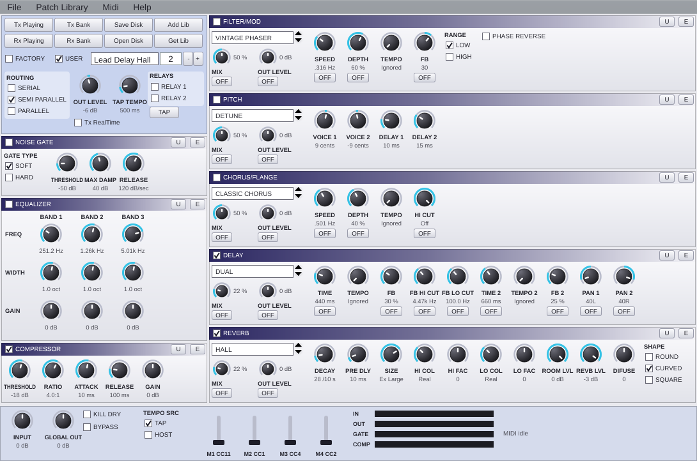
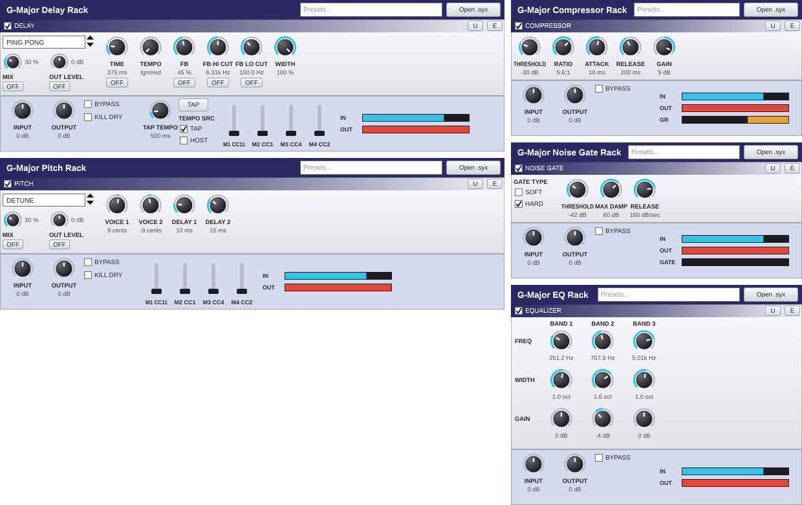

# G-Major Reborn

[](https://github.com/RalfPearlRand/G-Major-Reborn/actions/workflows/ci.yml)

Reconstrução independente, em C++17/JUCE, do processador de efeitos de guitarra **TC Electronic G•Major** e do editor **GLydian**. Disponível como plugin **VST3** e aplicativo **Standalone** para Windows 10/11 x64.



- **Processamento de áudio**: Noise Gate, EQ de 3 bandas, Compressor, Filter/Mod, Pitch, Chorus/Flanger, Delay e Reverb.
- **Presets compatíveis com o hardware** (`.syx` de 615 bytes), obtidos por engenharia reversa do GLydian.
- **Comunicação MIDI com um G•Major**: envio e recebimento de presets, edit buffer, RealTime e backup dos 100 presets de usuário.
- **Modificadores M1–M4** para pedal de expressão, MIDI CC e automação.
- **122 parâmetros automatizáveis**.
- **Oito racks VST3 individuais** (v0.9.1), um para cada bloco de efeito.
- **Faixa de −50 a +50 dB** nos controles de nível adicionados na v0.9.1.



> O DSP foi implementado a partir do manual e **não foi comparado com um G•Major real**. Consulte [diferenças conhecidas](KNOWN_DIFFERENCES.md). Projeto independente e não afiliado à TC Electronic.

## Downloads

Baixe os instaladores e pacotes portáteis na página de [Releases](https://github.com/RalfPearlRand/G-Major-Reborn/releases). Os arquivos de cada versão incluem instruções específicas de instalação.

## Compilar e testar

Windows com Visual Studio 2022:

```bat
scripts\build-windows-msvc.bat
```

Core e testes, sem JUCE:

```bash
cmake -S . -B build -DGMR_BUILD_PLUGIN=OFF
cmake --build build --config Release --parallel
ctest --test-dir build -C Release --output-on-failure
```

O GitHub Actions executa os testes do core em Linux e Windows a cada push e pull request. Para requisitos completos, compilação do plugin e instalação, consulte [INSTALL.md](INSTALL.md).

## Documentação

| Documento | Conteúdo |
|---|---|
| [Instalação e compilação](INSTALL.md) | Instalação no Windows, uso e instruções de build |
| [Estrutura do projeto](docs/PROJECT_STRUCTURE.md) | Organização dos diretórios e arquivos |
| [Histórico de versões](CHANGELOG.md) | Alterações por versão |
| [Relatório de reconstrução](RECONSTRUCTION_REPORT.md) | Evidências, arquitetura e testes da reconstrução |
| [Diferenças conhecidas](KNOWN_DIFFERENCES.md) | Diferenças em relação ao GLydian e ao hardware |
| [Formato SysEx](docs/SYSEX_FORMAT.md) | Mapa do formato de preset |
| [Notas de DSP](docs/DSP_NOTES.md) | Algoritmos e constantes inferidas |

Veja também [como contribuir](CONTRIBUTING.md).

## Licença

GPL-3.0-or-later. Consulte [LICENSE.md](LICENSE.md). JUCE é utilizado sob GPLv3. O nome “G•Major” e a marca “TC Electronic” pertencem aos respectivos titulares e são mencionados apenas para identificar o equipamento compatível.
